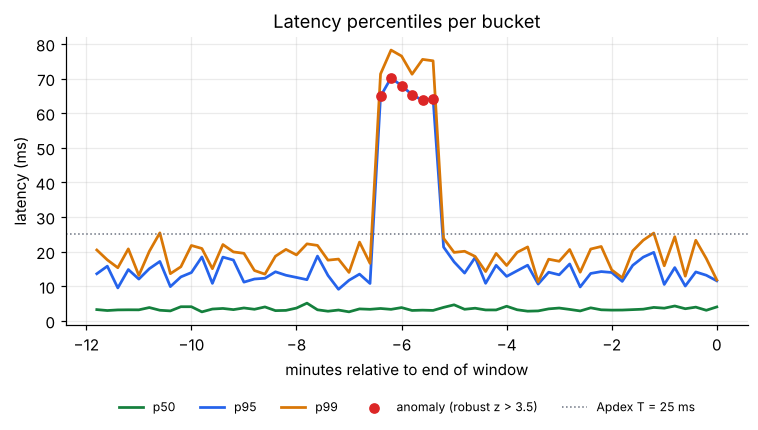
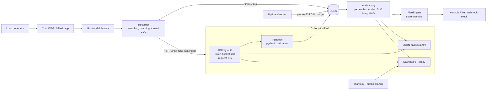
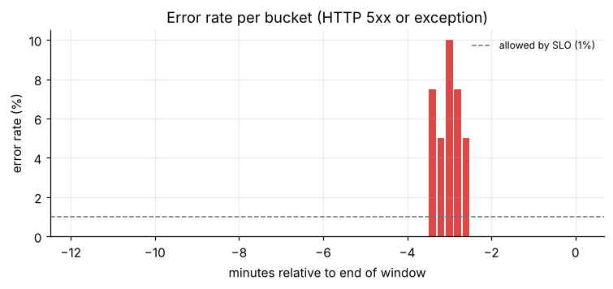
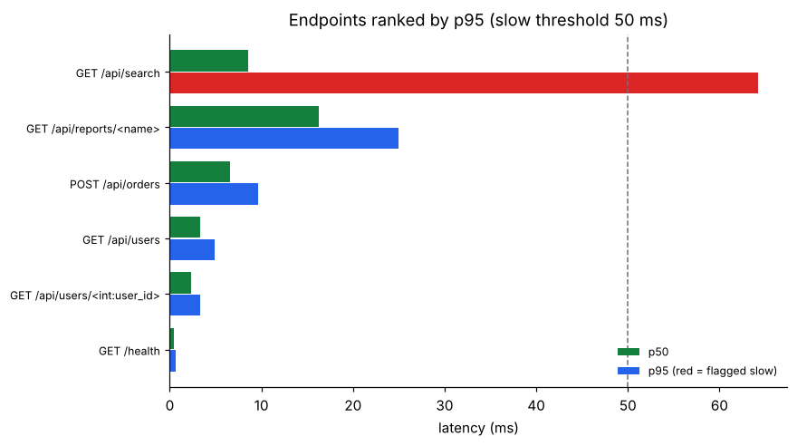
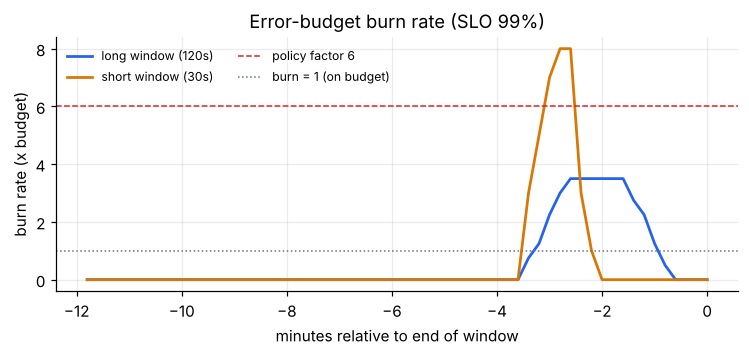

# apimon: API monitoring toolkit

A small, self-contained toolkit for watching an HTTP API: an embeddable **WSGI middleware** that records requests, a
**collector API** that stores and analyses them (latency percentiles, Apdex, SLO burn rate, anomaly detection), an
**active uptime checker**, **alert rules** with a state machine, and a server-rendered **developer dashboard**.
All demo traffic is **synthetic**; nothing here has been deployed or used by real users.

**ملخص بالعربية:** أداة لمراقبة واجهات API مبنية بـ Python وFlask وSQLite. تتضمن Middleware بصيغة WSGI لتسجيل الطلبات (المسار، الحالة، زمن الاستجابة، الأحجام، الأخطاء) مع أخذ عينات وكتابة دفعات، وخادم تجميع بمفاتيح API مُخزَّنة كـ hash وتحديد معدل الطلبات (Token Bucket)، وفاحص توفّر (Uptime) مع مهلة وإعادة محاولة، وتحليلات (p50/p95/p99، معدل الأخطاء، Apdex، معدل استهلاك ميزانية الأخطاء SLO، كشف الشذوذ بطريقة MAD)، وقواعد تنبيه بحالات (ok/pending/firing/resolved)، ولوحة تحكم HTML. جميع بيانات العرض التجريبي **اصطناعية**، والمشروع تعليمي/معرض أعمال وليس نظام إنتاج.



## Features

- **Middleware** (`apimon/middleware.py`): records route *template* (e.g. `/api/users/<int:user_id>`, not the raw path), method, status, latency, request/response bytes, exception type and request ID. Uniform sampling (events carry their `sample_rate`; analytics weight by `1/rate`), batched thread-safe writes (size- and interval-triggered), re-queue on sink failure, bounded buffer. Sinks: direct SQLite or HTTP to the collector. `instrument_flask(app, recorder)` adds route templates for Flask; any WSGI app works with path normalisation (`/users/123` becomes `/users/{id}`).
- **Collector API** (`apimon/collector.py`): project and endpoint registry, API keys stored as SHA-256 hashes, pydantic-validated ingestion (max 1000 events per call), in-memory token-bucket rate limit per key (429 + `Retry-After`), `X-Request-ID` propagation, JSON error bodies. See [`docs/API.md`](docs/API.md).
- **Uptime checker** (`apimon/uptime.py`): GET/HEAD probes with timeout, retry with exponential backoff, and assertions on status, latency and body substring. Tests and demo probe a local WSGI app on `127.0.0.1`.
- **Analytics** (`apimon/analytics.py`, numpy/pandas): p50/p95/p99, error rate (5xx or exception), throughput, Apdex, per-endpoint ranking with slow-endpoint flag, availability SLO with error-budget accounting and multi-window burn-rate policies (long AND short window must exceed the factor), upward latency anomalies via robust z-score (median/MAD, with a mean-absolute-deviation fallback when MAD is 0).
- **Alerts** (`apimon/alerts.py`): JSON rules (`examples/alerts.json`) over p50/p95/p99, error rate, Apdex, throughput, burn rate or uptime failure rate. State machine `ok -> pending -> firing -> resolved -> ok`, `for_evaluations` debounce, per-rule cooldown that suppresses repeat firing notifications, and mock sinks: console, JSONL file, webhook-mock (records the payload; never opens a socket).
- **Dashboard** (`/dashboard`): Jinja2, no JavaScript, matplotlib PNG charts inlined (percentiles over time, error rate, endpoint ranking, SLO burn), endpoint table, anomalies, alert states, uptime results. Sample: [`docs/sample_dashboard.html`](docs/sample_dashboard.html).
- **Load generator** (`apimon/loadgen.py`, `scripts/loadgen.py`), argparse **CLI** (`python -m apimon -h`), logging, 33 pytest tests.

## Architecture


Data model: [`docs/DATA_MODEL.md`](docs/DATA_MODEL.md) (mermaid ER diagram).

**Why Flask + sqlite3:** FastAPI was not available in the environment this was built in (and no packages could be installed), so the collector uses Flask, the standard-library `sqlite3` and pydantic for validation.

## Quickstart

```bash
python -m pip install -r requirements.txt
python -m pytest -q                      # 33 tests
python scripts/demo.py                   # synthetic traffic, writes PNGs + sample dashboard into docs/

# run a collector
export APIMON_ADMIN_TOKEN=choose-a-secret
python -m apimon create-project my-service --db build/apimon.db     # prints an API key once
python -m apimon serve --db build/apimon.db --alerts examples/alerts.json
```

Instrumenting a Flask app (in-process, writing to the same database):

```python
from apimon.middleware import Recorder, SQLiteSink, instrument_flask
rec = Recorder(SQLiteSink("build/apimon.db", project_id=1), batch_size=100, sample_rate=1.0)
instrument_flask(app, rec, exclude_prefixes=("/static",))
```
For a remote collector use `HTTPSink("http://collector:8000", api_key)`.

## Real output (one run of `python scripts/demo.py`)

Everything below is **measured by running the code in a sandbox**. The load generator sends 2,400 synthetic requests
through the real middleware into the real ingestion endpoint (via Flask's test client, no sockets). Latencies are measured
from actual handler execution (handlers sleep a few milliseconds to simulate I/O); only the *timestamps* follow a virtual
clock so 12 minutes of traffic replay in about 15 seconds. A latency spike (+60 ms on `/api/search`) and an error burst
(60% failures on `/api/orders`) are injected on purpose. Latency numbers vary a little from run to run; counts are deterministic.

```
requests=2400 errors=14 error_rate=0.0058 rps=3.333 p50/p95/p99=3.4/16.6/63 ms apdex(T=25ms)=0.985
status mix: 200: 2009, 201: 344, 404: 33, 500: 8, 503: 6   (all 2400 events written, 0 dropped)
endpoints ranked by p95:
  GET  /api/search                n=368  p50=8.6   p95=64.4  slow=True
  GET  /api/reports/<name>        n=183  p50=16.3  p95=25.0
  POST /api/orders                n=358  p50=6.7   p95=9.6   err=0.039
  ...
/api/search p95 outside spike 12.6 ms vs inside 77.8 ms
/api/orders error rate outside burst 0.000 vs inside 0.560
anomalous buckets (robust z > 3.5), seconds from start: [336, 348, 360, 372, 384, 396]  (spike injected 324s-396s)
peak 30s burn rate: 8.0 (SLO 99%); error budget remaining over the window: 0.4167
alerts: high_p95_latency fired then resolved; error_burst fired then resolved; slo_burn_fast fired then resolved
uptime (local probe app): ok UP; flaky-retry UP after 2 attempts; slow-vs-100ms DOWN (151 ms > 100 ms);
                          wrong-status DOWN (503); refused DOWN (connection refused)
middleware overhead on a trivial route (test client, best of 3): between -7 and +19 us/request on top of ~125-140 us across runs, i.e. roughly 0-15%, noisy
```

| | |
|---|---|
|  |  |
|  | |

Burn-rate windows in the demo are scaled down (120s/30s and 360s/60s) to fit a 12-minute replay; the library defaults are the
common 1h/5m and 6h/30m policies.

## Project structure

```
apimon/            middleware.py collector.py db.py analytics.py alerts.py uptime.py ratelimit.py
                   report.py charts.py loadgen.py demoapp.py probe_app.py cli.py templates/dashboard.html
examples/          alerts.json checks.json
scripts/           demo.py loadgen.py
tests/             test_core.py test_services.py conftest.py
docs/              API.md DATA_MODEL.md *.png sample_dashboard.html
.github/workflows/ ci.yml (pytest on Python 3.11, 3.12, 3.13)
```

## Testing

`python -m pytest -q` runs 33 tests: middleware (route templates, sizes, exceptions, request IDs, sampling, concurrent
writers), token bucket, key hashing and auth, ingestion validation, rate-limit 429s, analytics against hand-computed values,
SLO burn, MAD anomalies, the alert state machine including cooldown, sinks, uptime checks against a local server on
127.0.0.1 (success, bad status, latency assertion, timeout, retry, connection refused), dashboard, CLI and an end-to-end
load-generator run. Tests use Flask's test client; no external network is used. The tests were run only in the Python 3.13
sandbox; the CI matrix for 3.11/3.12 has not been run here.

## Limitations

- **Single process, learning project.** Rate-limit state is in memory; SQLite with one collector process; not load-tested or deployed, no multi-tenant hardening.
- Analytics read raw rows with pandas on every request (no rollups or retention), so it will slow down on large tables.
- Sampling is uniform; percentiles are computed on the recorded sample and are not weighted.
- SLO covers availability only (5xx or exception); no latency SLO. Anomaly detection is on bucketed p95 and only flags upward spikes.
- API keys use plain SHA-256 (fine for 192-bit random tokens, not for passwords). No key rotation/revocation endpoint, no TLS, no CSRF concerns because the dashboard is read-only; the dashboard takes the key in the query string, which can leak into logs. Do not expose it publicly as is.
- Uptime check URLs are operator-configured and are not restricted to local hosts; do not accept them from untrusted users.
- Demo data is synthetic and timestamps are virtual; latencies are real but tiny (milliseconds), so the thresholds are demo-scale.
- Webhook sink is a mock: no real HTTP delivery. Middleware measures time until the response body is consumed, not network time to the client.

## Roadmap

Key rotation/revocation, retention and rollup tables, latency SLOs, real webhook delivery behind an allow-list, async/FastAPI variant, OpenTelemetry-style trace IDs.

## License

MIT, see [LICENSE](LICENSE).
