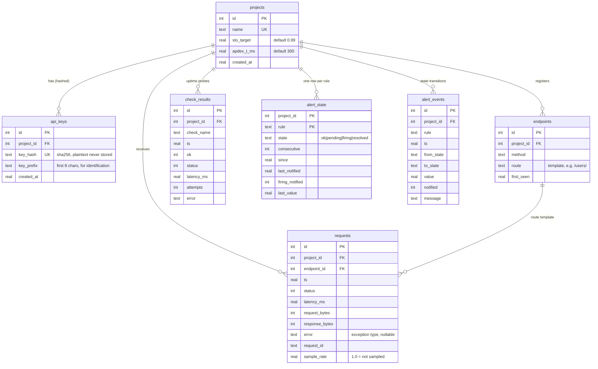

# Data model

SQLite schema defined in [`apimon/db.py`](../apimon/db.py). Timestamps are epoch seconds (REAL).

Notes: `requests` is indexed on `(project_id, ts)`. Alert rules and uptime check definitions live in JSON config files, not in the database.
